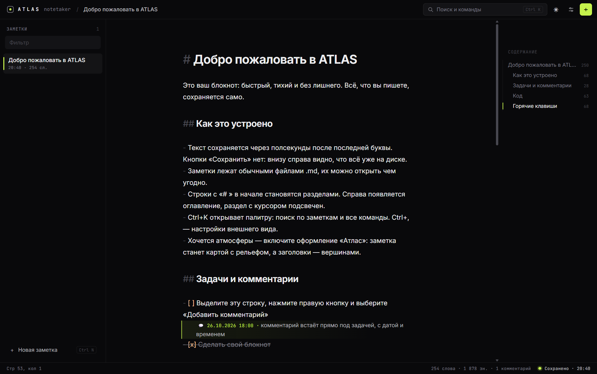
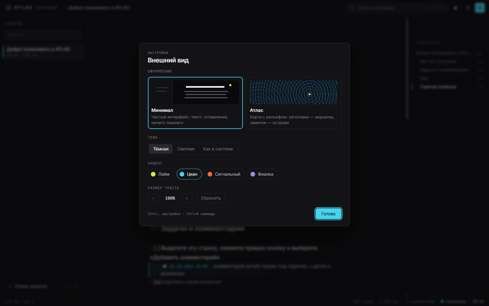
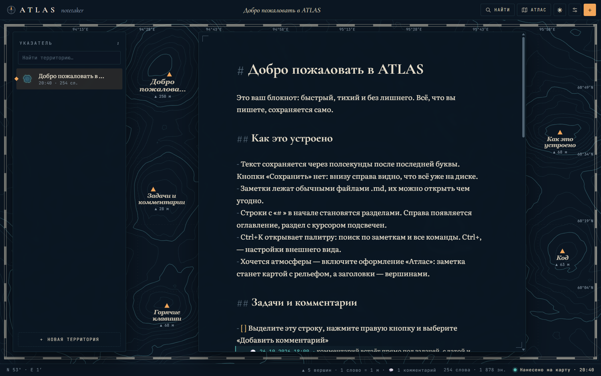

# ATLAS Notetaker

Локальный блокнот на Markdown: пишешь — сохраняется, код подсвечивается, у задач есть комментарии с датой. Заметки остаются обычными `.md`-файлами на твоём диске. Рядом с заметками — библиотека для чтения: PDF, EPUB, FB2, DOCX, Markdown, TXT и HTML, с цитатами прямо в заметки. Есть для Windows и для Android.



## Установка

**MSI.** Скачай `ATLASTaker-<версия>-x64.msi` со страницы [Releases](https://github.com/saint-1406/ATLASTaker/releases) и запусти. Установщик кладёт приложение в `Program Files` (нужны права администратора) и создаёт ярлыки в меню «Пуск» и на рабочем столе. Внутри своя копия Node, отдельно ничего ставить не нужно.

**Без установки.** Архив `ATLASTaker-<версия>-portable.zip` оттуда же: распакуй и запусти `ATLAS Notetaker.cmd` в папке. Работает так же, как установленная версия: окно Edge или Chrome, заметки в той же папке `%APPDATA%\ATLAS Notetaker`.

**Android.** `ATLASTaker-<версия>-android.apk` оттуда же. Скачай на телефон и открой; Android попросит разрешить установку из этого источника (браузера или файлового менеджера). Заметки и книги живут в приложении на телефоне, копия заметок — «Скачать все заметки (.zip)» через лупу. Книгу можно открыть прямо из другого приложения: «Открыть с помощью» или «Поделиться» → ATLAS. Следующие версии ставятся поверх, заметки остаются.

**Из исходников** (нужен Node 22+):

```bash
npm install
npm start
```

`npm run shortcut` создаёт ярлыки на рабочем столе и в «Пуске» для запуска из исходников.

**Браузерная версия.** Один файл `ATLAS-Notetaker.html` без установки, без Node и без сервера: открывается двойным щелчком или в окне Edge. Заметки хранятся в IndexedDB браузера. Если очистить данные браузера, они пропадут, поэтому есть «Скачать все заметки (.zip)» и «Импорт .md» (Ctrl+K или Ctrl+,), а если копии не было неделю, ATLAS напоминает сам. Подходит для компьютеров, где ничего нельзя ставить.

```bash
npm run build:browser
```

Собирает `out/browser/ATLAS-Notetaker.html`. Команда `npm run install:browser` ещё и копирует его в `%LOCALAPPDATA%\ATLAS Notetaker\browser` и ставит ярлык «ATLAS Notetaker (браузер)», который открывает файл в Edge как отдельное приложение.

## Что умеет

- **Автосохранение.** Текст пишется на диск через 0,4 с после последней буквы, при закрытии окна дописывается остаток. Если сервер упал или его сменило обновление посреди работы, несохранённое лежит в аварийной копии: при следующем запуске ATLAS покажет, что нашёл, и спросит, что вернуть. Невозвращённое не пропадает — оно ложится файлом в `backups\несохранённое\`. Курсор, прокрутка и настройки переживают перезапуск.
- **Код.** `/#` в начале строки открывает блок кода (или Ctrl+E), `/#` внутри блока — выход из него. Блоки ```` ```язык ```` подсвечиваются (больше сотни языков), у каждого блока кнопка «Копировать». Вставленный код сам оборачивается в блок с угаданным языком, Ctrl+Z снимает обёртку.
- **Комментарии к задачам.** Правая кнопка на строке → «Добавить комментарий» (или Ctrl+Shift+M). Комментарий встаёт под строку с датой и временем: `💬 26.10.2026 17:52 · текст`. В окне комментария видна история прошлых.
- **Картинки и скриншоты.** Win+Shift+S, затем Ctrl+V прямо в заметке — или перетащи файл. Картинка показывается под строкой ``, щелчок открывает её на весь экран. В установленной версии файлы лежат в `notes\assets\` рядом с заметками, в браузерной — в IndexedDB; резервная копия .zip забирает их в папку `assets/`.
- **Палитра Ctrl+K.** Поиск по заметкам (по названию и по тексту) и все команды в одном месте; `>` в начале — только команды.
- **Оглавление.** Заголовки заметки справа, раздел с курсором подсвечен, клик переносит к разделу.
- **Режим фокуса** (Ctrl+.): только текст, всё, кроме текущей строки, приглушено.
- **Диктовка** (кнопка с микрофоном в углу или Ctrl+Shift+D). Пока говоришь, слова видны серым у курсора; законченная фраза встаёт в текст с нужным пробелом и заглавной буквой. «Новая строка» и «новый абзац» — команды, а не слова. На Android слушает системное распознавание речи (на новых телефонах — и без интернета, если скачан языковой пакет); в Edge и Chrome — сервис браузера, онлайн: звук уходит в облако Microsoft или Google. Остановить — ещё раз на микрофон или Esc.
- **Библиотека** (кнопка с книгами или Ctrl+O). PDF, EPUB, FB2 (и FB2 в zip), DOCX, Markdown, TXT и HTML ложатся на полку с обложкой и процентом прочитанного; файлы можно перетащить прямо на полку. Книга открывается там, где остановился, ☰ — оглавление, «Aa» — вид: размер текста, шрифт, интервал, тема и режим чтения. Читать можно лентой или **по страницам**, слева направо: свайп, тап по краю страницы, стрелки или колесо. Перелистывание на выбор — «Книга» (страница переворачивается через корешок), «Стопка» (новая ложится поверх), «Сдвиг», «Растворение» или «Сразу»; при системной настройке «уменьшить движение» анимации нет. Выдели абзац → «В заметку»: он ляжет цитатой в заметку «Цитаты: <книга>» с главой или страницей. Старые `.doc` не читаются — их надо пересохранить в `.docx`. Текст книг показывается без скриптов и стилей самого файла, только знакомые теги.

## Оформления

Ctrl+, открывает настройки: язык, оформление, тема, акцент и размер текста.

**Темы.** Тёмная и светлая, а для разных глаз и времени суток — **Сепия** (тёплая бумага для долгого чтения), **Сумерки** (мягкая сине-серая тёмная), **Ночь** (чёрная для AMOLED-экранов, тёплый неяркий текст без резкого синего) и **Контраст** (белое на чёрном, жёлтые метки, заметная рамка фокуса). Или «Как в системе». Тему можно сменить и прямо в читалке, в панели «Aa».

**Язык.** Интерфейс говорит по-русски и по-английски: «Язык · Language» в настройках или команда «Language: English» в Ctrl+K, переключается сразу, без перезагрузки. При первом запуске язык берётся из браузера, и приветственная заметка будет на нём же; у тех, кто пользовался ATLAS раньше, остаётся русский. Папки бэкапов (`до обновления`, `ежедневная`, `несохранённое`) называются по-прежнему на любом языке.

| | |
| --- | --- |
| **Минимал** — по умолчанию. Монохром, тонкие линии, Inter и JetBrains Mono, один акцентный цвет на выбор. |  |
| **Атлас** — каждая заметка становится картой с рельефом: заголовки превращаются в вершины на полях, все заметки вместе — в архипелаг (Ctrl+M). |  |

## Где лежат заметки

`%APPDATA%\ATLAS Notetaker\notes\` — обычные `.md`-файлы. Даты, позиция курсора и настройки лежат там же в `atlas.json`. Удалённые заметки переезжают в `notes\.trash\`. Удаление программы заметки не трогает.

Документы библиотеки — в `%APPDATA%\ATLAS Notetaker\library\`, как есть, с карточками в `library.json`; удалённые уходят в `library\.trash\`.

Резервные копии — в `%APPDATA%\ATLAS Notetaker\backups\`: копия всех заметок при первом запуске новой версии («до обновления») и раз в день («ежедневная»), хранятся 20 последних. Картинки в копиях — жёсткие ссылки, места они не занимают. Папку открывает команда «Папка бэкапов» в Ctrl+K или кнопка в настройках.

## Как устроено

Интерфейс открывается в установленном Edge или Chrome в режиме приложения (`--app`), без вкладок и адресной строки. Файлы пишет маленький сервер на Node, который слушает только `127.0.0.1`. Своего браузера приложение не тащит, поэтому установщик весит около 30 МБ, а запускается там, где неподписанные `.exe` запрещены политикой.

Сервер проверяет заголовок `Host` и принимает запросы к API только с токеном текущего запуска, который видит лишь своя страница. Запись атомарная (временный файл и переименование), более новая запись всегда побеждает ту, что ещё в пути. На одну папку с заметками может работать только один сервер.

## Разработка

```bash
npm test
```

```bash
npm run serve -- --port 5183 --data .dev-data
```

```bash
npm run watch
```

| Папка | Что внутри |
| --- | --- |
| `server/` | HTTP-сервер, хранилище заметок и библиотеки, запускалка окна |
| `src/` | интерфейс: редактор (CodeMirror 6), оформления, оглавление, палитра, карта «Атласа», библиотека |
| `src/reader/` | читалка (отдельный бандл `dist/reader.js`): разбор FB2, EPUB, DOCX, Markdown, TXT, HTML и PDF через pdf.js |
| `android/` | приложение для Android: WebView с той же страницей, «Открыть с помощью», сохранение файлов |
| `tests/` | тесты `node:test` |
| `installer/` | описание MSI для WiX 5 и файлы portable-версии |
| `scripts/` | раскладка для установщика и для Android, иконка, ярлыки |

**Релиз.** Подними версию в `package.json` (`npm version 0.7.0 --no-git-tag-version`), запушь `main`, дождись зелёной сборки и отправь тег:

```bash
git tag v0.7.0
```

```bash
git push origin v0.7.0
```

GitHub Actions прогонит тесты, соберёт MSI, portable-zip и APK и опубликует их в Releases. Каждый пуш в `main` собирает те же файлы как артефакты сборки.

APK подписывается ключом из секретов репозитория `ANDROID_KEYSTORE_B64` (файл `.p12` в base64) и `ANDROID_KEYSTORE_PASSWORD`. Ключ один на все версии: телефон ставит обновление поверх только с той же подписью. Без секретов сборка релиза останавливается, а обычная сборка подписывает APK отладочным ключом.
