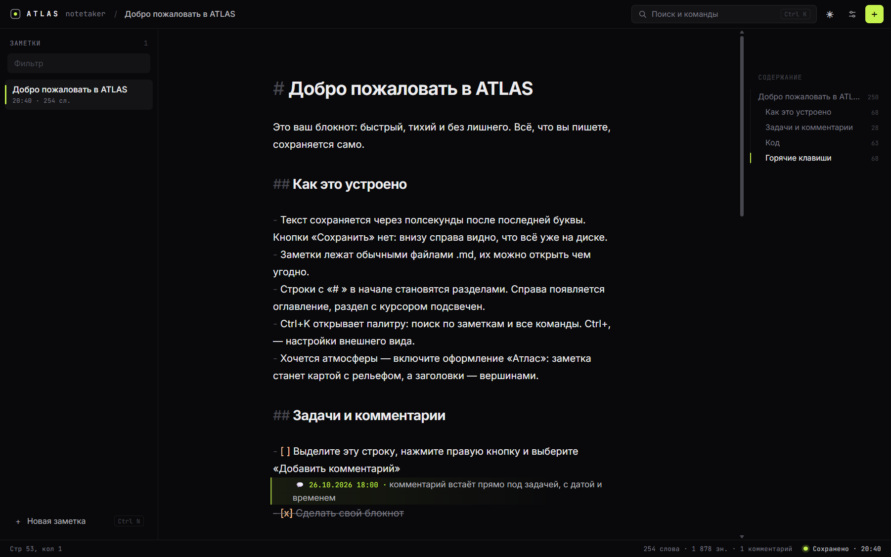

# ATLAS Notetaker

**English** · [Русский](README.ru.md)

A local-first notepad and reading app. Notes are written in a visual editor and kept as plain Markdown (`.md`) files on your own disk. Next to them is a library for reading PDF, EPUB, FB2, DOCX, ODT, RTF, Markdown, TXT, HTML, CBZ comics and pictures, with highlights, comments, bookmarks and quotes into notes. It runs on Windows, Android and iPhone; Windows and Android sync through your own Google Drive. The interface speaks English and Russian.



## Install

Download from the latest [release](https://github.com/saint-1406/ATLASTaker/releases/latest):

| File | For |
| --- | --- |
| `ATLASTaker-<version>-x64.msi` | **Windows**, installed into Program Files (administrator rights needed), with Start menu and desktop shortcuts. Node is inside: nothing else to install. |
| `ATLASTaker-<version>-portable.zip` | **Windows without installing**: unzip anywhere and run `ATLAS Notetaker.cmd`. Same app, same notes folder as the installed one. |
| `ATLASTaker-<version>-android.apk` | **Android 8 and later**: open it on the phone and allow installing from that source. Later versions install over it (or from inside the app); notes and books stay. |
| `ATLASTaker-<version>-ios.ipa` | **iPhone and iPad**: an unsigned app that you sign with your own Apple ID while installing it with Sideloadly. A free Apple ID's signature lasts 7 days and is then renewed; notes and books stay. Step by step: [docs/ios-install.md](docs/ios-install.md) (in Russian). |
| `SHA256SUMS.txt` | The checksums of the files above. |

**From source** (Node 22 or later):

```bash
npm install
npm start
```

`npm run shortcut` adds desktop and Start menu shortcuts that run the app from the source folder.

**Browser build.** One `ATLAS-Notetaker.html` file: no installing, no Node, no server, for computers where nothing may be installed. Notes live in the browser's IndexedDB, so the app offers "Download all notes (.zip)" and ".md import", and reminds you when there has been no copy for a week. `npm run build:browser` makes `out/browser/ATLAS-Notetaker.html`; `npm run install:browser` also copies it to `%LOCALAPPDATA%\ATLAS Notetaker\browser` and adds a shortcut that opens it in Edge as an app.

## Notes

- **A visual editor.** Buttons change how the text looks, not visible Markdown marks; the file stays plain Markdown, and a source mode shows it as typed. Headings, bold, italic, underline, strikethrough, lists that continue on Enter, tasks with a box to tick, quotes, code blocks with highlighting, links, tables, pictures and collapsible accordion blocks. Opening a note never rewrites it.
- **One bar at the foot** with the kind of paragraph, the formats (a pressed one stays on until pressed again), blocks, pictures, links and the note's menu; which buttons it has and in what order is up to you. On a phone it sits right above the keyboard.
- **Autosave.** Text reaches the disk 0.4 s after the last key. If the server goes away mid-sentence, the unsaved text waits in a rescue copy and is offered back at the next start; what is not taken back goes to `backups\несохранённое\`, never lost.
- **Pictures and screenshots.** Paste a screenshot (Win+Shift+S, then Ctrl+V) or drop a file; on a phone, pick one from the gallery or the camera. A click opens it full screen.
- **Comments on task lines.** Right click → "Add comment" (Ctrl+Shift+M) puts a dated line under the task, `💬 26.10.2026 17:52 · text`, with the earlier ones shown.
- **Tags.** Write `#word`, or select text and mark it with a tag; the list of tags gathers them from every note and leads to the lines they stand on.
- **Version history.** While you write, a version is kept at most every 10 minutes; any one can be compared with the text now (lines in and out) and put back, and ↶ undoes that.
- **Writing statistics.** Over the note: characters, words, sentences, paragraphs, reading time and typing speed (it folds to one line). A tap shows how much you wrote and how the text grew today, this week and this month, the days in a row, and a heat map of the last half year.
- **Back and forward one step** (↶ ↷, Ctrl+Z / Ctrl+Y) on every screen: the note's text; a book's marks, bookmarks and texts; deletions, moves and folders in Notes and the Library.
- **Focus mode** (Ctrl+.): only the text, with everything but the paragraph or sentence you are writing faded.
- **Reading a note.** On a phone a note with text opens for reading, so a stray tap changes nothing; ✎ turns writing on.
- **Export** a note to Markdown, plain text, a web page (pictures inside) or PDF (through printing: "Save as PDF").
- **Ctrl+K** finds notes by title and text and runs every command; the outline on the side lists the headings.
- **Dictation** (the microphone, or Ctrl+Shift+D): the words show grey at the cursor, and a finished phrase goes in with its spacing and capital letter. Android uses its own speech recognition (offline where the language pack is downloaded); Edge and Chrome use their online service.
- **Translation** of a selection, Russian ↔ English: MyMemory online (free, no key); without the internet, Firefox's own offline engine (its models, about 42 MB a direction, downloaded once and checked) or the phone's.
- **Document scanner** (Android): the camera or the gallery, the sheet's edges found and adjustable, the perspective straightened, the text read on the phone (PaddleOCR, Russian and English, no network) and saved as a note or a TXT file.

## Library and reader

- **Formats:** PDF, EPUB, FB2 (also zipped), DOCX, ODT, RTF, Markdown, TXT, HTML, CBZ comics (page by page) and pictures (JPEG, PNG, WebP: a scan or a photo of a page). Old `.doc` files need saving as `.docx` first.
- **The shelf:** covers and progress, sections, and **series** (a series lies as one folder, its books by part). Files can be dropped right onto it; on Android, "Open with" or "Share" → ATLAS.
- **Reading** as one scroll or **by pages**: swipe, tap an edge, arrow keys or the wheel. Page turns: Book (the corner lifts and the page folds over, following your finger), Stack, Slide, Fade or None, with a speed slider; none when the system asks for reduced motion. On Android, the screen's full refresh rate or 60 Hz.
- **Reading looks:** themes, font, size, spacing and margins, in the "Aa" panel.
- **Highlights** in colours, with comments, grouped by colour in the list; **bookmarks** with notes about what happens at that place, and their history; **texts** written onto PDF pages. A deleted one waits in the trash.
- **Search** in a document (Ctrl+F): the whole text, any case, across line breaks, with a list of every place.
- **Quotes** go into a "Quotes: <book>" note with the chapter or page; Ctrl+click on the quote opens the book exactly there.
- **PDF editing:** rotate, remove, reorder and add pages; edit a line of text in place; save highlights and texts into a copy as real PDF annotations that Acrobat, Edge and Chrome show.
- **Apocrypha, a shared library:** a collection of public domain classics (searched by title, author and language, each download checked against its checksum, the list kept for offline use), and books readers share from their own Google Drive.

## Sync, safety and updates

- **Sync through Google Drive** (Account): notes, folders, books with their reading place, highlights, bookmarks, the trash and every setting are shared between Windows (MSI and portable) and Android. Only the app's own Drive folder is used. A fresh install takes its settings from Drive instead of overwriting them.
- **The trash** keeps deleted notes, books, highlights, comments and bookmarks whole until you restore them or delete them for good from there; it syncs too.
- **A PIN** (Settings → Protection) locks the app on that device, and locks it again after a while in the background. Only a salted hash of the PIN is kept; it keeps the notes from other eyes in the app but does not encrypt the files on the disk.
- **Backups on Windows:** a copy of every note before each update and once a day; the last 20 are kept.
- **Updates:** on Android the app downloads the new version from GitHub and checks its size, SHA-256, package, version and signing key before Android installs it over the old one. On Windows the app tells you of a new version and opens its download page.

## Looks

Settings (Ctrl+,): language, look, theme, accent, text size and animations.

- **Looks:** **Cosy** (the default: warm paper, serif titles, soft cards), **Minimal** (monochrome, fine lines, one accent colour) and **Atlas** (each note becomes a relief map, its headings peaks in the margins, all notes an archipelago: Ctrl+M).
- **Themes:** light and dark, **Sepia** for long reading, **Dusk** (a soft blue-grey dark), **Night** (black for AMOLED screens, warm dim text), **Contrast** (white on black, yellow marks), or the system's.
- **Language:** English or Russian, switched at once; at the first start it follows the browser.

## Where your data lives

On Windows, in `%APPDATA%\ATLAS Notetaker`:

| Folder | What |
| --- | --- |
| `notes\` | the notes as plain `.md` files; dates, cursor places and settings in `atlas.json`; deleted notes in `notes\.trash\`, earlier versions in `notes\.versions\` |
| `library\` | the documents as they are, their cards in `library.json`; deleted ones in `library\.trash\` |
| `backups\` | the copies before updates and the daily ones |
| `server.log` | what the local server reports: its starts, why it stopped, errors |

Uninstalling the app leaves all of it. On Android and iPhone everything lives inside the app; "Download all notes (.zip)" makes a copy, and on Android sync keeps one on Drive.

## How it works

On Windows the interface opens in the installed Edge or Chrome as an app window (`--app`: no tabs, no address bar). A small Node server writes the files and listens on `127.0.0.1` only: it checks the `Host` header and takes API requests only with the current run's token, which only its own page sees. Writes are atomic (a temporary file, then a rename), a newer write always beats an older one still under way, and only one server may own a notes folder. The app brings no browser of its own, so the installer is about 30 MB, and it runs where unsigned `.exe` files are blocked by policy. The window holds a line open to the server, and the portable app's keeper starts the server again if it ever stops while the window is open.

On Android the same page runs in a WebView (served from the app's assets), on iPhone in a WKWebView; notes and books are kept in the page's IndexedDB there.

## Development

```bash
npm test                 # unit tests (node:test)
npm run test:editor      # the editor's browser tests (first: npx playwright install chromium)
npm run serve -- --port 5183 --data .dev-data
npm run watch
```

| Folder | What |
| --- | --- |
| `server/` | the HTTP server, the notes and library stores, sync on Windows, the launcher and the portable keeper |
| `src/` | the interface: the editor, looks, outline, palette, the Atlas map, the library, sync |
| `src/rich/`, `src/noteEditor.js` | the visual editor (ProseMirror): its model, safe conversion to and from Markdown, saving |
| `src/reader/` | the reader (its own bundle, `dist/reader.js`): FB2, EPUB, DOCX, ODT, RTF, CBZ, pictures, Markdown, TXT, HTML, and PDF through pdf.js and pdf-lib |
| `android/` | the Android app: a WebView with the same page, "Open with", file saving, speech, translation, the scanner |
| `ios/` | the iPhone app: a WKWebView with the same page |
| `apocrypha/` | the shared library's catalogue (a Cloudflare Worker) |
| `installer/` | the MSI (WiX 5) and the portable app's files |
| `scripts/` | staging for the installer, Android and iPhone, icons, shortcuts |
| `tests/` | the tests |

**A release.** Raise the version (`npm version 0.20.0 --no-git-tag-version`), push `main`, wait for a green build, then push a tag:

```bash
git tag -a v0.20.0 -m "ATLAS Notetaker v0.20.0"
git push origin v0.20.0
```

GitHub Actions runs the tests, starts the staged Windows app to check that it answers, builds the MSI, the portable zip, the APK and the IPA, and publishes them with their checksums. Every push to `main` builds the same files as build artifacts. The APK is signed with the key in the repository secrets `ANDROID_KEYSTORE_B64` and `ANDROID_KEYSTORE_PASSWORD`: one key for every version, since a phone installs an update over the app only with the same signature.
